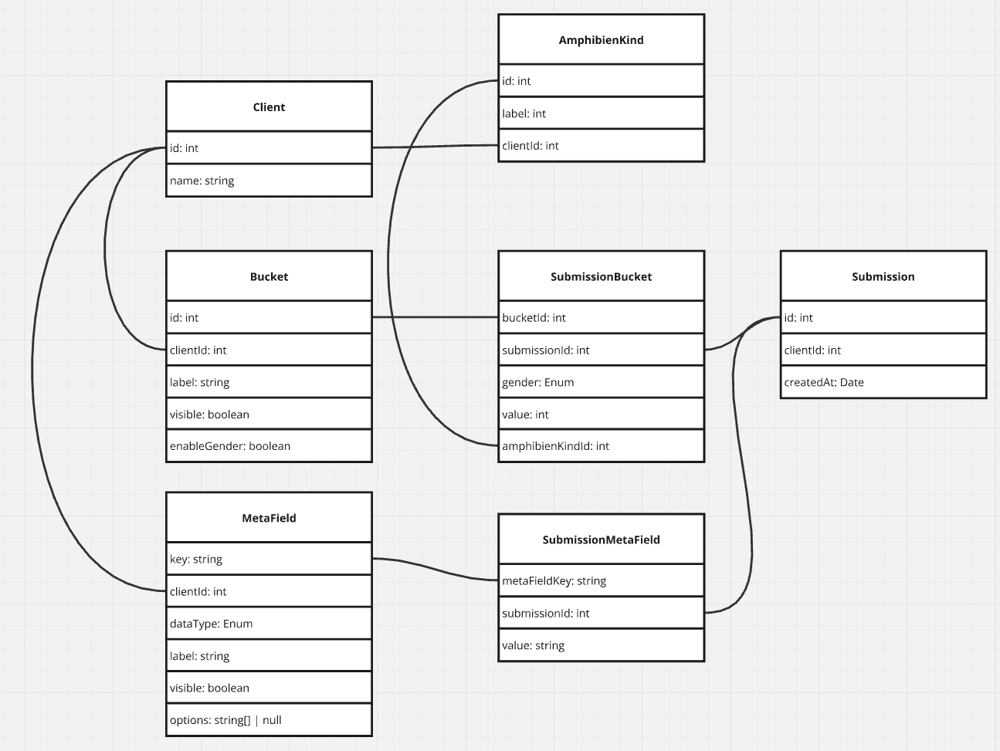

**Requirements**

- flexible number of buckets with label support
- activating/deactivating buckets dynamically
- collect meta data such as weather, temperature, date, participants, outward journey / return journey
- excel export of data for a certain date range
  - nice to have: custom excel exports for different clients
- (generate graph images)
- password login
- create / edit submissions
- allow different configurations of amphibien types
- migration script for data import from old mongo database

**Libraries**

- NextJS as React framework
- Use native API routes for endpoints
- `typed-rest` as REST layer
- Prisma as ORM
- `react-hook-form` for forms
- `next-auth` for authentication
- UI library?

**Database Model**

